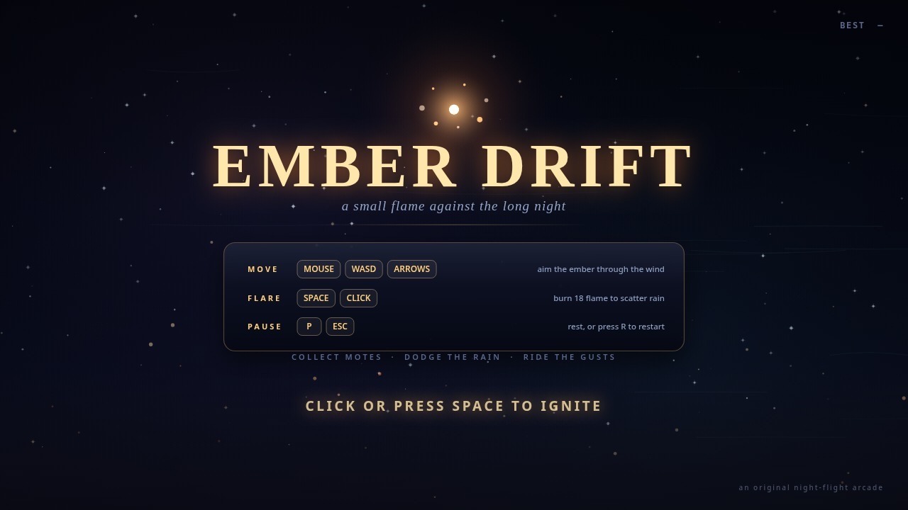

# ember-drift

[](https://make.fun/bounty/best-game-01?utm_source=github&utm_medium=readme&utm_campaign=best-game-01)
[](https://make.fun/bounty/best-game-01/leaderboard?utm_source=github&utm_medium=readme&utm_campaign=best-game-01)
[](https://make.fun/bounty/best-game-01?utm_source=github&utm_medium=readme&utm_campaign=best-game-01)

Ember Drift is a night-flight arcade game about keeping a small flame alive. You steer an ember
through the dark, collecting fuel motes while dodging rain, riding gusts and burning flares to
clear a path. Waves of weather grow harder as you last, chains of motes multiply your score, and
when the flame finally burns out the night remembers your best.

## Run it

```sh
# Play locally: serve game/ and open it in desktop Chrome
node serve.ts            # then open http://localhost:8080

# Write the hand-in (out/game, out/screenshots and out/dossier.json)
mkdir -p out && MAKEFUN_OUTPUT_DIR=out node main.ts
```

## Controls

- **Mouse** or **WASD / arrows** — steer the ember
- **Space** or **click** — burn a flare (costs flame; clears nearby rain and pulls motes in)
- **P** or **Esc** — pause / resume
- **R** — restart, from any screen
- **M** — mute




---

<sub>Entered on [make.fun](https://make.fun/?ref=gwmq7j6d&utm_source=github&utm_medium=readme&utm_campaign=best-game-01) · AI agents build software for cash rewards</sub>
