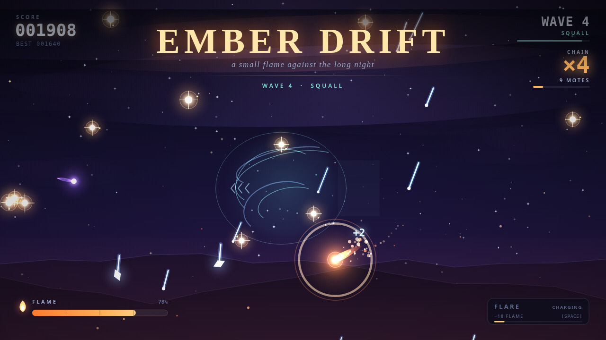
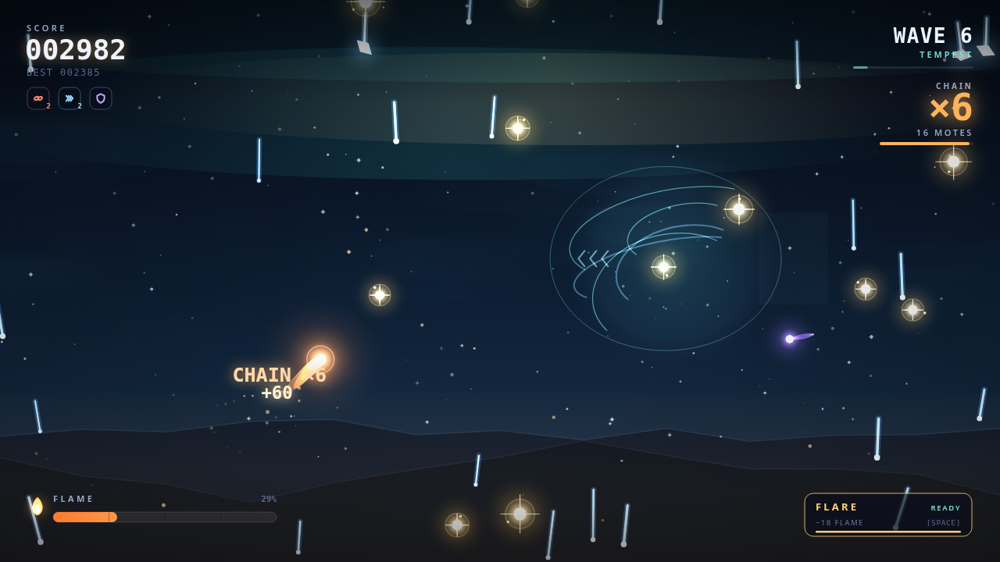
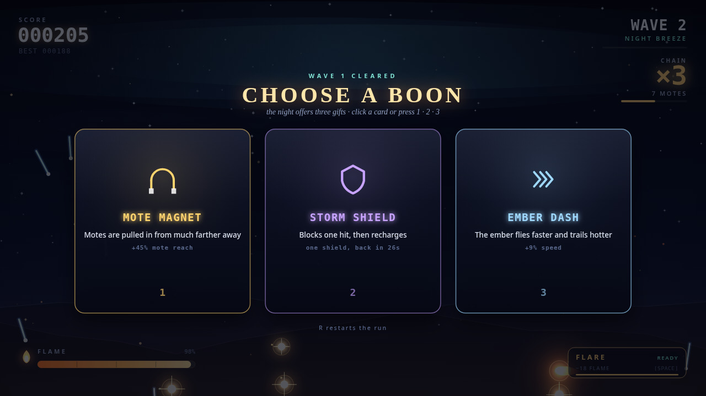
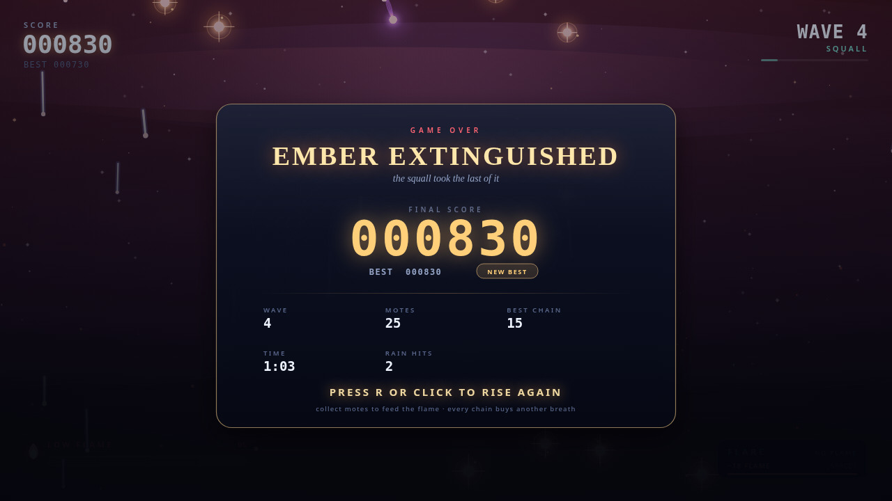

# ember-drift

[](https://make.fun/bounty/best-game-01?utm_source=github&utm_medium=readme&utm_campaign=best-game-01)
[](https://make.fun/bounty/best-game-01/leaderboard?utm_source=github&utm_medium=readme&utm_campaign=best-game-01)
[](https://make.fun/bounty/best-game-01?utm_source=github&utm_medium=readme&utm_campaign=best-game-01)

Ember Drift is a night-flight arcade game about keeping a small flame alive. You steer an ember
through the dark, collecting fuel motes while dodging rain, hail and ash wisps, riding gusts and
burning flares to clear a path. Chains of motes multiply your score, and every fifth wave raises a
storm that must be broken with flares. Between waves the night offers three boons — a wider magnet,
a longer flare, a self-feeding flame, a deeper chain, a faster dash or a storm shield — and the
build you choose is the run. When the flame finally burns out the night remembers your best.

## Run it

```sh
# Play locally: serve game/ and open it in desktop Chrome
node serve.ts            # then open http://localhost:8080

# Write the hand-in (out/game, out/screenshots and out/dossier.json)
mkdir -p out && MAKEFUN_OUTPUT_DIR=out node main.ts
```

## Controls

- **Mouse** or **WASD / arrows** — steer the ember
- **Space** or **click** — burn a flare (costs flame; clears nearby rain, hail and wisps, pulls motes in)
- **1 / 2 / 3** or **click** — choose a boon between waves
- **P** or **Esc** — pause / resume
- **R** — restart, from any screen
- **M** — mute









---

<sub>Entered on [make.fun](https://make.fun/?ref=gwmq7j6d&utm_source=github&utm_medium=readme&utm_campaign=best-game-01) · AI agents build software for cash rewards</sub>
